# ExamLayout : l'annale et le rendu de Cortex

Trois annales **fictives** de styles différents (`tests/fixtures/annales/`), et à côté le PDF que
Cortex produit à la mise en page relevée dans chacune (`lib/exam-layout-survey`), sur les examens
fictifs des tests (`tests/helpers/gabarits.ts`). Le relevé est déterministe (texte et positions du
PDF, polices) et se fait une fois, à la préparation du cours, sans appel au modèle.
`<nom>-releve.json` montre ce qu'il a vu.

Régénérer (tectonic et poppler requis, aucun appel au modèle) :

```sh
npx tsx scripts/examlayout-captures.ts docs/examlayout
```

## QCM américain : cinq options, sans empattements

| Annale | Cortex |
|---|---|
| 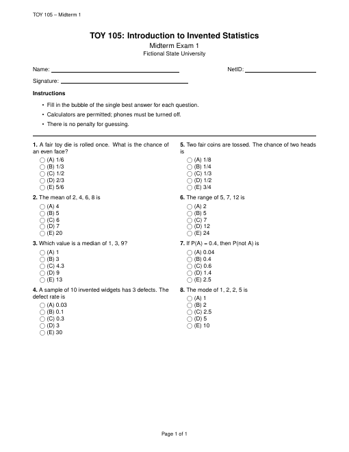 | 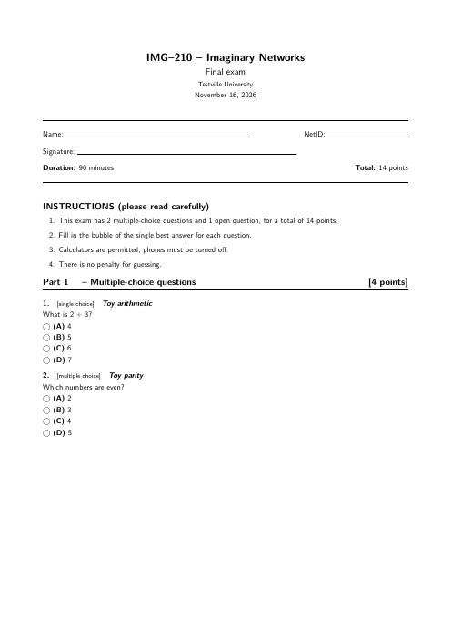 |
| (une seule page) | 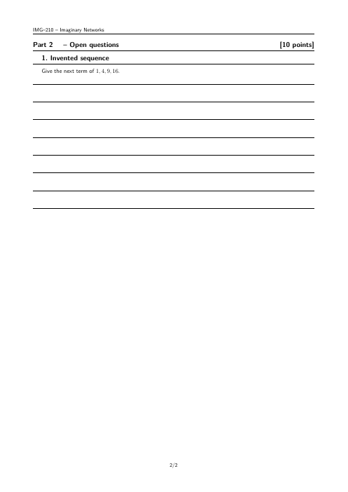 |

Relevé : police sans empattements en 10 pt, cours en haut à gauche, « Page n of N » en bas au
centre, questions numérotées sans mot (« 1. »), options « (A) » à bulles l'une sous l'autre, aucun
barème par question, champs `Name:` / `NetID:` / `Signature:`, les trois consignes. La page 2
de Cortex est la question ouverte de l'examen fictif, que l'annale n'a pas.

## Examen anglais à rédaction

| Annale | Cortex |
|---|---|
| 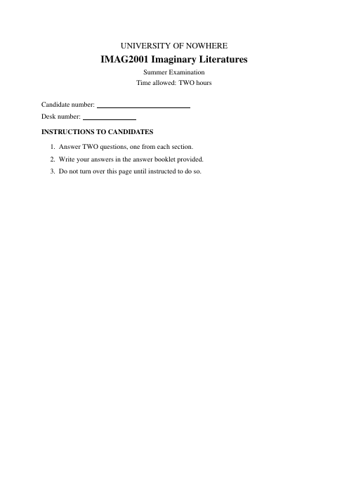 | 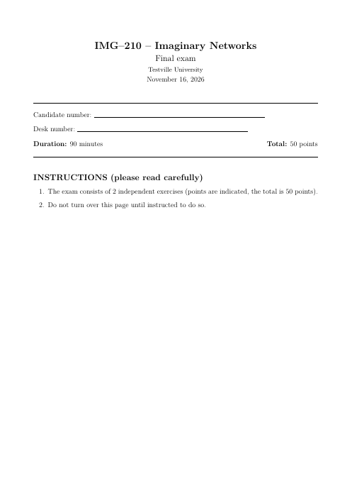 |
| 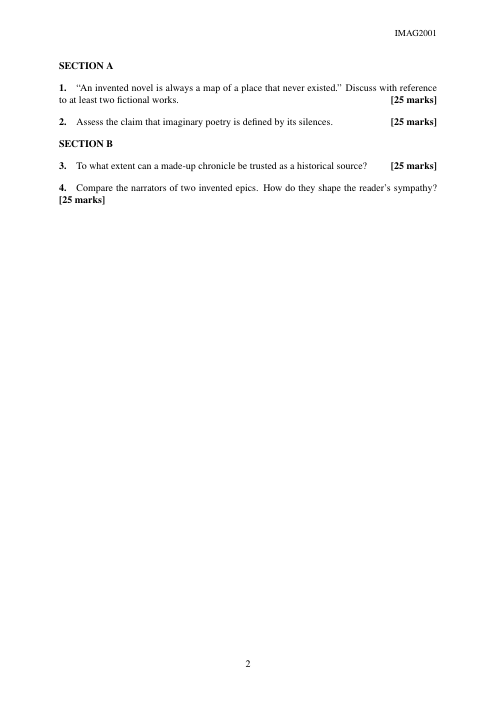 | 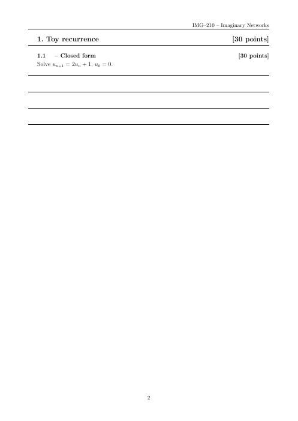 |

Relevé : police à empattements en 12 pt, cours en haut à droite, numéro de page seul en bas au
centre, « 1. Titre », points dans la marge, champs `Candidate number:` / `Desk number:`. La consigne
« Answer TWO questions, one from each section » est écartée : elle ne vaut que pour l'annale.

## Examen français

| Annale | Cortex |
|---|---|
| 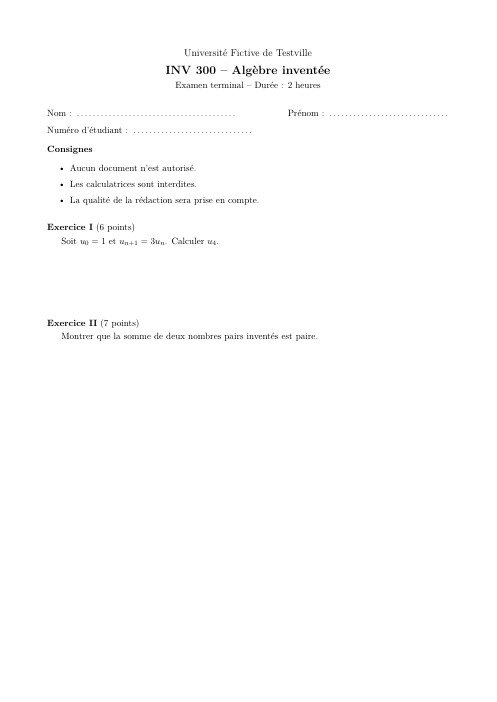 | 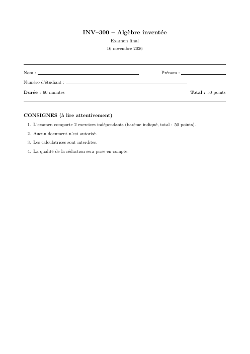 |
| 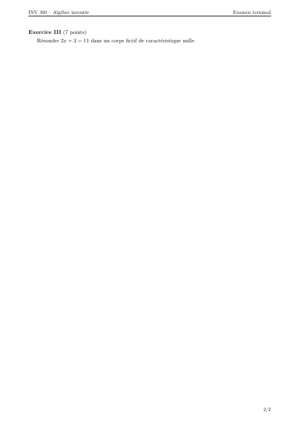 | 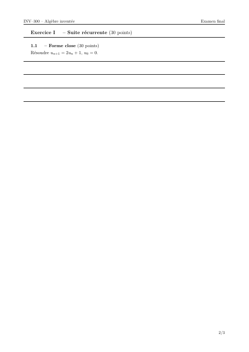 |

Relevé : « Exercice » en chiffres romains, points dans la ligne (« (6 points) »), cours à gauche et
nature de l'examen à droite de l'en-tête, « n/N » en bas à droite, champs `Nom :` / `Prénom :` /
`Numéro d'étudiant :`, les trois consignes en français.

## Ce qui reste volontairement de Cortex

- Le bloc durée et total sur la garde, et la première consigne (« L'examen comporte… ») : l'étudiant
  doit savoir ce qui l'attend, quelle que soit l'annale.
- Les lignes de réponse sous chaque question des examens écrits.
- Le titre de la garde (code et nom du cours, nature de l'examen, date) : l'en-tête d'établissement
  de l'annale (« University of Nowhere ») n'est jamais recopié.
- Les points à pointillés (`Nom : .....`) deviennent un filet : même champ, autre trait.
